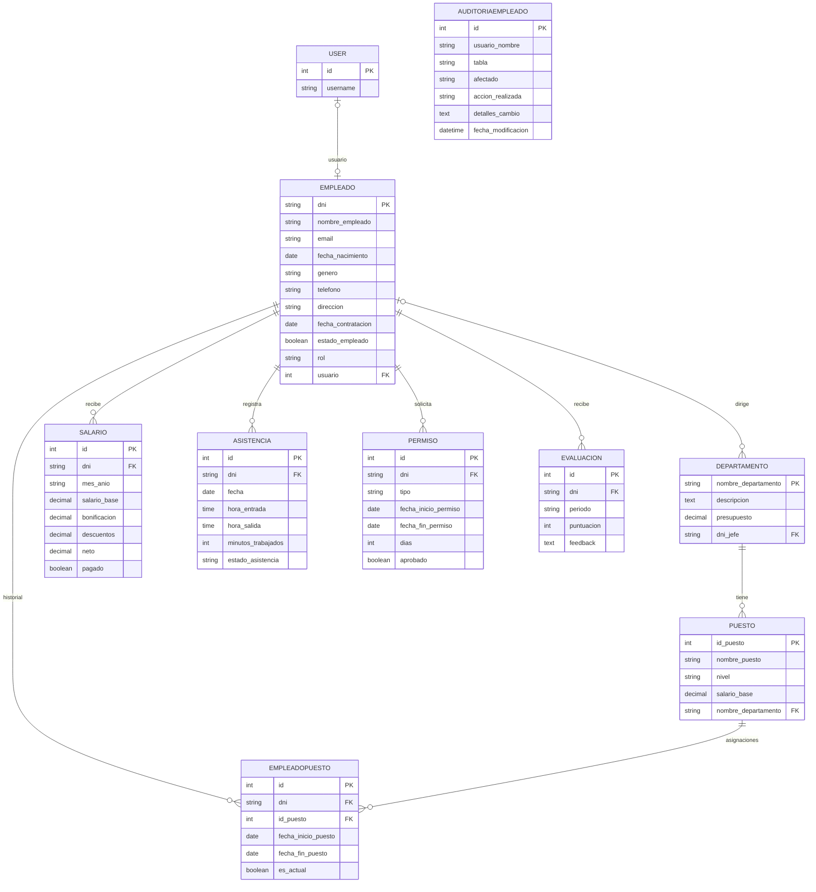

# Control RRHH

Sistema web de gestión de recursos humanos hecho con Django. Proyecto de la asignatura Programación Back End (TI3V41), INACAP.

Integrantes: Carmen Quezada, Marllecelly Parra, Juan Carlos Parra, Kevin Garcés, Jennifer Pérez.

## Qué hace

Administra empleados, departamentos, puestos, sueldos, asistencia, permisos y evaluaciones de desempeño. Cada usuario inicia sesión con su RUT (sin puntos, con guion, por ejemplo 12345678-9) y ve el panel que corresponde a su rol:

- Empleado: ve sus datos, historial de puestos, sueldos y evaluaciones. Solicita permisos y marca entrada y salida.
- Jefe: ve a su equipo, aprueba o rechaza permisos, revisa asistencia, consulta sueldos, descarga el Excel de nómina de su equipo y gestiona evaluaciones.
- RRHH: ve toda la empresa por departamento, próximos permisos, evaluaciones pendientes, sueldos en dólares y descarga el Excel de nómina completo.

Crear, editar y eliminar registros se hace desde el admin de Django (/admin/). Los cambios sobre empleados quedan en una tabla de auditoría que no se puede editar ni borrar.

## Tecnologías

Python 3.12, Django 4.2, PostgreSQL, openpyxl, numpy, requests y python-dotenv.

## Modelo de datos



Resumen de las tablas:

- Empleado: datos personales y rol (JEFE, RRHH o EMPLEADO). Se enlaza uno a uno con el usuario de Django, que es el que permite iniciar sesión. La clave primaria es el RUT.
- Departamento: áreas de la empresa, con presupuesto y un empleado como jefe.
- Puesto: cargos de un departamento, con nivel y salario base. No puede repetirse el nombre dentro del mismo departamento.
- EmpleadoPuesto: historial de puestos de cada empleado. Es la tabla intermedia de la relación muchos a muchos entre Empleado y Puesto.
- Salario: un registro por empleado y mes (formato MM-AAAA). El neto se calcula solo al guardar: base más bonificación menos descuentos.
- Asistencia: un registro por empleado y día. Los minutos trabajados se calculan solos al guardar.
- Permiso: solicitudes de ausencia, pendientes, aprobadas o rechazadas. Los días se calculan solos, contando solo días hábiles (sin fines de semana ni feriados).
- Evaluacion: una por empleado y semestre (formato AAAA-S1 o AAAA-S2), con puntuación de 1 a 5.
- AuditoriaEmpleado: registro de cambios hechos desde el admin. Solo permite crear registros, no editarlos ni borrarlos.

## Instalación

Se necesita Python 3.12 y Git. El proyecto usa una base PostgreSQL en línea compartida por el equipo.

1. Clonar el repositorio.

```
git clone https://github.com/Kurotha/Control-RRHH.git
cd Control-RRHH
```

2. Crear y activar un entorno virtual.

En Windows:

```
python -m venv venv
venv\Scripts\activate
```

En Linux o macOS:

```
python3 -m venv venv
source venv/bin/activate
```

3. Instalar las dependencias.

```
pip install -r requirements.txt
```

4. Crear el archivo .env en la raíz del proyecto (junto a manage.py). No está en el repositorio por seguridad: las credenciales se entregan por separado.

5. Levantar el servidor.

```
python manage.py runserver
```

La aplicación queda en http://127.0.0.1:8000/login/ y el admin en http://127.0.0.1:8000/admin/.

## Estructura

```
gestion_rrhh/   configuración del proyecto (settings, urls)
rrhh/           aplicación principal (modelos, vistas, admin, plantillas)
utils/          cálculo de fechas y feriados, sueldos y conversión de moneda
templates/      plantillas del admin personalizado
static/         estilos del admin personalizado
data/           datos de ejemplo en Excel
```

## Seguridad

Control de acceso por rol en cada vista, protección CSRF en los formularios, validación de datos en los modelos, consultas con el ORM de Django y claves fuera del código, en el archivo .env.

## Servicios externos

- mindicador.cl: valor del dólar, para mostrar sueldos en USD. El valor de cada fecha se guarda en la caché de Django durante 24 horas; si la API no responde se usa un valor de respaldo.
- boostr.cl: feriados de Chile, para contar días hábiles en los permisos.
